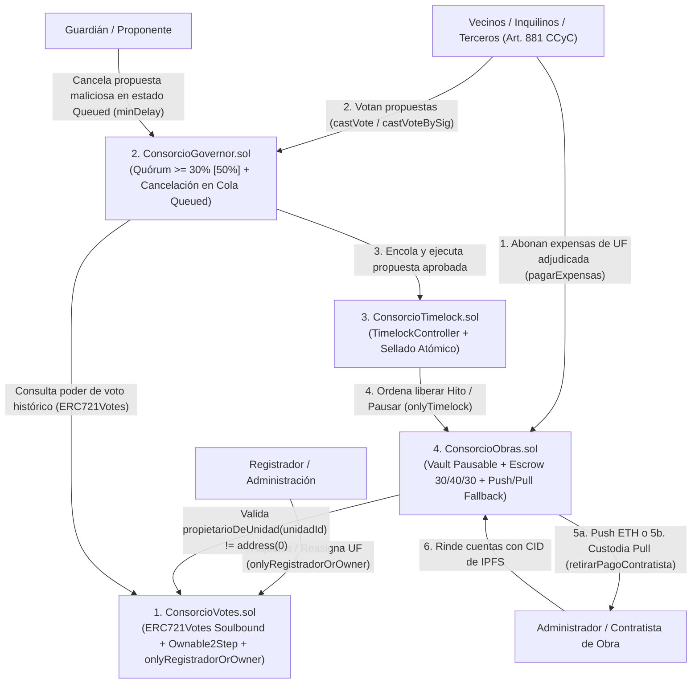
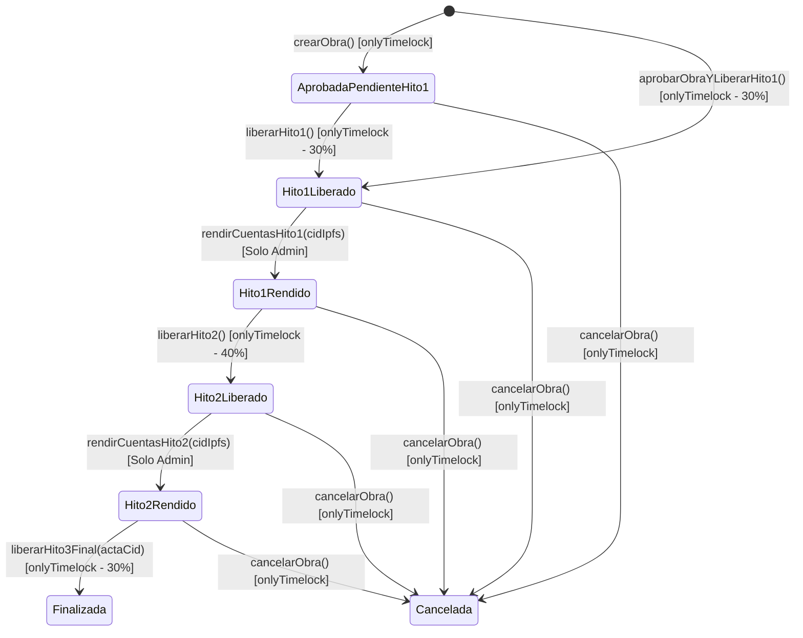

# ADM-Consorcios (`ConsorcioDAO` V2) — Gobernanza On-Chain con NFTs Soulbound (`ERC721Votes`), Timelock y Bóveda de Obras por Hitos (`Push + Pull Fallback`)

**Trabajo Práctico Final Integrador — Ethereum Developer Pack (ETH Kipu · Nivel 2)**

---

## 1. ¿Qué hace el proyecto y cuál es su propuesta de valor?

**ADM-Consorcios (`ConsorcioDAO` V2)** es un protocolo descentralizado de gobernanza y tesorería programable (*Milestone Escrow Vault*) diseñado para **consorcios de copropietarios, barrios privados (countries) y comunidades habitacionales** bajo el régimen jurídico de Propiedad Horizontal.

El sistema resuelve uno de los problemas financieros y de confianza más frecuentes en la administración de propiedades horizontales y urbanizaciones cerradas: **la opacidad en la recaudación de expensas, el desvío o discrecionalidad en el manejo de la caja común y el pago de obras de infraestructura sin control de avance real**.

### Análisis de la Solución: ¿Por qué tiene sentido usar Blockchain para este problema?

1. **Custodia sin intermediarios de confianza (*Trustless Vault*):** En el modelo tradicional, los fondos de expensas descansan en una cuenta bancaria controlada unilateralmente por el Administrador. En `ConsorcioDAO`, los fondos residen en el contrato inteligente [`ConsorcioObras.sol`](./contracts/ConsorcioObras.sol), donde **ninguna persona física puede retirar dinero por su cuenta**: toda erogación requiere una propuesta aprobada por el voto de los propietarios ([`ConsorcioGovernor.sol`](./contracts/ConsorcioGovernor.sol)) con **quórum estatutario del 50%** (mínimo estricto del 30%) y el cumplimiento de una ventana temporal de seguridad ([`ConsorcioTimelock.sol`](./contracts/ConsorcioTimelock.sol)).
2. **Liberación condicionada por Hitos (30% / 40% / 30%) y Rendición de Cuentas en IPFS:** A diferencia de un pago único tradicional, el contrato inteligente divide cada presupuesto aprobado en **tres etapas estrictas**:
   - **Hito 1 (30% — Anticipo y compra de materiales):** Se libera al aprobarse la obra.
   - **Hito 2 (40% — Avance intermedio):** El contrato **bloquea criptográficamente** este pago hasta que el Administrador/Contratista registre en la blockchain el hash IPFS (`CID`) con las facturas, remitos y fotografías de avance del Hito 1, y los vecinos aprueben la segunda liberación.
   - **Hito 3 (30% — Entrega final):** Exige la rendición de cuentas previa del Hito 2 en IPFS y la aprobación final de cierre de obra.
3. **Esquema Híbrido `Push + Pull Fallback` ante Contratistas Incompatibles:** Si al ejecutarse un hito desde el Timelock el contratista es un contrato inteligente cuya función `receive()` revierte o consume gas excesivo, la transacción del Timelock **no revierte ni queda bloqueada**: los fondos quedan acreditados en custodia segura (`pagosPendientesContratista[destinatario]`) para retiro posterior por la vía `retirarPagoContratista(receptor)`.
4. **Poder de voto ligado al inmueble mediante NFTs Soulbound (`ERC721Votes`) con Doble Vía Operativa (`onlyRegistradorOrOwner`):** Cada Unidad Funcional o Lote (ej. Lote `101`, UF `102`) está representado por un **NFT único (`tokenId == unidadId`)** en [`ConsorcioVotes.sol`](./contracts/ConsorcioVotes.sol) basado en `ERC721Votes` y `Ownable2Step` de OpenZeppelin v5. Es **intransferible entre particulares** (*Soulbound*), eliminando de raíz los ataques de préstamo rápido (*flash-loan governance attacks*), mientras permite que tanto el `ConsorcioTimelock` (`owner` soberano) como el `registrador` (administración del consorcio tras verificar escrituras) adjudiquen y reasignen unidades sin burocracia de bloqueo.

---

## 2. Arquitectura General del Sistema

El backend on-chain está compuesto por **4 contratos inteligentes modulares** en Solidity `^0.8.24` construidos sobre las primitivas auditadas de **OpenZeppelin Contracts v5.1.0**:



### Detalle de los 4 Contratos (`/contracts`)

| Contrato | Estándar Base | Responsabilidad Principal |
| :--- | :--- | :--- |
| **[`ConsorcioVotes.sol`](./contracts/ConsorcioVotes.sol)** | `ERC721`, `EIP712`, `ERC721Votes`, `Ownable2Step` | Emite un NFT único por unidad funcional (`tokenId = unidadId` en `adjudicarUnidad`), auto-delega el poder de voto al propietario, bloquea transferencias libres (`_update` Soulbound), exige transferencia de propiedad en 2 pasos (`Ownable2Step`) e incorpora el rol `registrador` con doble vía `onlyRegistradorOrOwner` para alta y reasignación de unidades (`reasignarUnidad`). Usa reloj en modo timestamp (`EIP-6372`). |
| **[`ConsorcioTimelock.sol`](./contracts/ConsorcioTimelock.sol)** | `TimelockController` (`AccessControl`) | Bóveda de retardo temporal desplegada con listas `proposers=[]` y `executors=[]` vacías. Impone una espera obligatoria (`minDelay = 60s` en testnet) entre la aprobación de una propuesta y la salida efectiva de fondos. Incluye la función de sellado atómico `configurarYSellarGobernanza(address governor)` que asigna `PROPOSER_ROLE`, `EXECUTOR_ROLE` y `CANCELLER_ROLE` al Governor y revoca inmediatamente el `DEFAULT_ADMIN_ROLE` del deployer en una sola transacción. |
| **[`ConsorcioGovernor.sol`](./contracts/ConsorcioGovernor.sol)** | `Governor`, `GovernorSettings`, `GovernorCountingSimple`, `GovernorVotes`, `GovernorVotesQuorumFraction`, `GovernorTimelockControl` | Motor de gobernanza. Exige en su constructor que `_votingPeriod > 0` y que el quórum esté en el rango seguro `[30%, 100%]` (`QUORUM_MINIMO = 30`, desplegado con **`50%`**). Incorpora el rol `guardian` y la función `cancelarPropuestaEnCola(...)` para cancelar propuestas en estado `Queued` durante el `minDelay` del Timelock. |
| **[`ConsorcioObras.sol`](./contracts/ConsorcioObras.sol)** | `ReentrancyGuard`, `Pausable` + Máquina de Estados de Hitos + `Push/Pull Fallback` | Bóveda (Vault) que recibe en su constructor `(address _timelock, address _consorcioVotes)`. En `pagarExpensas` verifica on-chain que `consorcioVotes.propietarioDeUnidad(unidadId) != address(0)` (`UnidadNoAdjudicada`) permitiendo el pago por cualquier billetera (propietario, inquilino o tercero según Art. 881 CCyC). Implementa liberación híbrida `Push + Pull Fallback` (`_transferirETH` + `retirarPagoContratista`), protege todas las liberaciones con `onlyTimelock`, incorpora freno de emergencia (`pausarVault` / `reanudarVault`) y exige rendición de cuentas en IPFS antes de destrabar los Hitos 2 y 3. |

### Máquina de Estados de una Obra en `ConsorcioObras.sol`



---

## 3. Remediación Integral de las 6 Observaciones de la Mentoría Docente (`[CORRECCIÓN DOCENTE - PUNTOS 1 AL 6]`)

En esta versión **V2** se abordaron, implementaron y verificaron exhaustivamente las **6 observaciones planteadas por el docente** durante la revisión de mentoría:

### 3.1. `[CORRECCIÓN DOCENTE - PUNTO 1]`: Quórum Estatutario en `ConsorcioGovernor.sol` (`QUORUM_MINIMO = 30`, Despliegue al `50%`) y Demostración Matemática / Echidna

- **Observación del Docente:** Con un consorcio pequeño (ej. 4 unidades funcionales) y un quórum bajo (como `4%` o `10%`), la división entera en Solidity `(totalSupply * quorumNumerator) / 100` truncaba a `0` (`(4 * 4) / 100 = 0`), permitiendo aprobar propuestas sin un piso real de participación. Asimismo, se pidió verificar que nunca ocurra división por cero y documentar la alternativa teórica con `override`.
- **Solución Implementada en [`ConsorcioGovernor.sol`](./contracts/ConsorcioGovernor.sol):**
  1. Se elevó la constante `uint256 public constant QUORUM_MINIMO = 30;` (30% mínimo estricto en el constructor) y el protocolo fue desplegado en Sepolia con **`QUORUM_PERCENTAGE = 50` (50% de quórum estatutario)**.
  2. Con `totalSupply = 4` unidades y `quorumNumerator = 50`, el cálculo estándar de OpenZeppelin `GovernorVotesQuorumFraction` arroja exactamente:
     $$\text{quorum}(t) = \left\lfloor \frac{4 \times 50}{100} \right\rfloor = 2 \text{ votos}$$
  3. **Imposibilidad de División por Cero:** En `GovernorVotesQuorumFraction` (OpenZeppelin v5), `quorumDenominator()` es una función `pure` que retorna la constante literal `100` (`return 100;`), por lo que el divisor jamás puede ser `0`.
  4. **Verificación Formal con Foundry Fuzzing e Invariantes + Echidna:**
     - Test Fuzz `testFuzz_Caso1_QuorumSinDivisionPorCeroYMinimo2Para4Unidades(uint256,uint256)` (`256 runs`).
     - Invariante de Foundry `invariant_QuorumNuncaCeroNiDivisionPorCero()` (`16,384 calls`).
     - Invariante de Echidna `echidna_quorum_sin_division_por_cero_y_mayor_a_cero()` (`5,190 secuencias`).
  5. **Alternativa Teórica de Redondeo hacia Arriba / Piso de 1 Voto (Documentada sin alterar la fórmula estándar de OpenZeppelin):**
     Si un consorcio deseara permitir porcentajes menores al 25% en padrones reducidos garantizando siempre al menos `1` voto mediante redondeo hacia arriba (*ceil division*), podría sobreescribirse teóricamente `quorum(uint256 timepoint)` en `ConsorcioGovernor.sol` del siguiente modo:
     ```solidity
     // Alternativa teórica documentada (NO activada en producción para preservar la semántica estándar de OZ v5):
     function quorum(uint256 timepoint)
         public
         view
         override(Governor, GovernorVotesQuorumFraction)
         returns (uint256)
     {
         uint256 supply = token().getPastTotalSupply(timepoint);
         if (supply == 0) return 0;
         uint256 num = supply * quorumNumerator(timepoint);
         uint256 den = quorumDenominator(); // Siempre 100
         uint256 q = (num + den - 1) / den; // Ceil division
         return q == 0 ? 1 : q;
     }
     ```

---

### 3.2. `[CORRECCIÓN DOCENTE - PUNTO 2]`: Esquema Híbrido `Push + Pull Fallback` para Liberación de Fondos al Contratista en `ConsorcioObras.sol`

- **Observación del Docente:** Si el destinatario de una obra (`administradorOContratista`) es un contrato inteligente que rechaza transferencias directas de ETH (carece de `receive()`/`fallback()` o revierte al recibir fondos), una transferencia puramente *Push* haría revertir la ejecución de la propuesta en el `ConsorcioTimelock`, bloqueando el avance contable de la obra.
- **Solución Implementada en [`ConsorcioObras.sol`](./contracts/ConsorcioObras.sol):**
  1. Se implementó un patrón híbrido **`Push + Pull Fallback`** dentro de `_transferirETH(address payable destinatario, uint256 monto)`:
     - Primero intenta la transferencia directa (*Push*): `(bool exito, ) = destinatario.call{value: monto}("");`.
     - Si `exito == false`, **no revierte la transacción del Timelock**: acredita el monto en `pagosPendientesContratista[destinatario] += monto`, incrementa el pasivo exigible `totalPagosPendientesContratistas += monto` y emite el evento `PagoContratistaEnCustodia(destinatario, monto)`.
  2. **Blindaje de Solvencia del Vault:** La función `saldoLibreDisponible()` descuenta tanto `fondosComprometidosEnObras` como `totalPagosPendientesContratistas`, impidiendo que el consorcio utilice en nuevas obras el ETH que ya pertenece a un contratista en custodia *Pull*:
     $$\text{saldoLibreDisponible} = \text{address(this).balance} - (\text{fondosComprometidosEnObras} + \text{totalPagosPendientesContratistas})$$
  3. **Retiro Seguro (*Pull*) hacia Billetera Alternativa:** El contratista afectado puede reclamar sus fondos en cualquier momento invocando `retirarPagoContratista(address payable receptor) external nonReentrant`, indicando cualquier dirección `receptor` válida que sí acepte ETH.

---

### 3.3. `[CORRECCIÓN DOCENTE - PUNTO 3]`: Validación On-Chain de Unidad Adjudicada en `pagarExpensas` y Pago por Terceros (Art. 881 CCyC)

- **Observación del Docente:** En la versión inicial, `pagarExpensas(uint256 unidadId, ...)` no verificaba on-chain contra `ConsorcioVotes` que la `unidadId` estuviera efectivamente adjudicada, pudiendo imputarse pagos por error de tipeo a un lote inexistente (ej. `unidadId = 9999`). Al mismo tiempo, debía preservarse el derecho de que un inquilino, familiar o administrador pague la expensa de una unidad válida.
- **Solución Implementada en [`ConsorcioObras.sol`](./contracts/ConsorcioObras.sol):**
  1. Se inyectó en el constructor la referencia inmutable `IConsorcioVotes public immutable consorcioVotes;`.
  2. En `pagarExpensas(uint256 unidadId, string calldata concepto)` se verifica on-chain:
     ```solidity
     if (consorcioVotes.propietarioDeUnidad(unidadId) == address(0)) {
         revert UnidadNoAdjudicada(unidadId);
     }
     ```
  3. **Separación entre Existencia del Inmueble e Identidad del Pagador (`msg.sender`):** El contrato exige que la **Unidad Funcional exista y tenga titular registral**, pero **no restringe `msg.sender` al propietario del NFT**, permitiendo que un **inquilino, locatario, apoderado o familiar** abone las expensas de la unidad conforme al **Art. 881 del Código Civil y Comercial de la Nación (Pago por Tercero Interesado)**, sin otorgarle por ello derechos políticos de voto en `ConsorcioGovernor`.

---

### 3.4. `[CORRECCIÓN DOCENTE - PUNTO 4]`: Evaluación Arquitectónica Comparativa de Identificación de Persona Física (World ID vs. Social Login / ERC-4337 vs. Hash Registral On-Chain)

- **Observación del Docente:** Analizar y documentar arquitectónicamente cómo vincular o verificar la identidad real de la persona física detrás de cada billetera de copropietario sin vulnerar la privacidad pública en la blockchain (sin codificar dependencias de oráculos biométricos externos en los contratos de este MVP).

#### Tabla Comparativa de Alternativas de Identificación para `ConsorcioDAO`

| Criterio Arquitectónico | Alternativa A: **World ID (ZK Proof of Personhood - Semaphore)** | Alternativa B: **Social Login + Account Abstraction (`ERC-4337` + Paymaster)** | Alternativa C: **Registro On-Chain de Hash de Identidad (`bytes32 keccak256(DNI + salt)`)** |
| :--- | :--- | :--- | :--- |
| **Propósito Principal** | Demostrar criptográficamente unicidad humana (*1 humano = 1 identidad*) sin revelar datos personales (*Zero-Knowledge*). | Eliminar la fricción de semillas (*seed phrases*) y gas mediante OAuth (Google/Email/Passkeys) y cuentas inteligentes (`Smart Accounts`). | Vincular jurídicamente el inmueble (`unidadId`) con el expediente notarial/DNI del titular verificado por el Administrador/Escribano. |
| **Privacidad de Datos Personales (Ley 25.326 / GDPR)** | **Máxima:** Usa pruebas ZK-SNARKs sobre el árbol de Merkle de Semaphore (`nullifierHash`). Jamás expone nombre ni DNI on-chain. | **Alta on-chain / Media off-chain:** La blockchain solo ve la dirección del `Smart Account`, mientras el proveedor MPC/OAuth conoce el correo. | **Alta con Salt Criptográfico:** Al guardar solo `keccak256(abi.encodePacked(cuitDni, saltSecretoConsorcio))`, ningún observador externo puede revertir el hash ni obtener el DNI. |
| **Adecuación al Régimen de Propiedad Horizontal** | **Parcial:** En un consorcio el derecho de voto emana de la **titularidad dominial del inmueble** (una misma persona física o jurídica S.R.L. puede ser dueña legítima de 2 departamentos y tener 2 votos), mientras que World ID limita a 1 acción por ser humano. | **Excelente para UX Vecinal:** Resuelve el problema real de adopción en consorcios (vecinos no técnicos que pierden su clave privada o no tienen ETH para pagar gas al votar). | **Excelente para Validez Legal:** Permite auditar en asamblea que la billetera adjudicataria corresponde al titular de la escritura traslativa de dominio sin exponer su identidad públicamente. |
| **Mecanismo de Recuperación ante Pérdida de Clave** | No provee recuperación de billetera por sí mismo (requiere re-vincular nuevo address con el `nullifierHash`). | **Nativo:** Guardián social, Passkeys biométricas del dispositivo o rotación de firmantes en el `Smart Account` (`ERC-4337`). | **Nativo en `ConsorcioVotes.sol`:** El `registrador` o el `ConsorcioTimelock` ejecuta `reasignarUnidad(unidadId, nuevaWallet)` tras verificar el DNI físico contra el hash registrado. |
| **Costo de Gas y Complejidad de Integración** | Alto (~250k–300k gas por verificación de prueba ZK `verifyProof` on-chain + dependencia de disponibilidad de Orbs físicos). | Medio en despliegue de cuenta (`initCode`), subvencionable a $0 para el vecino mediante un `ERC-4337 Paymaster` financiado por la caja del consorcio. | Mínimo (~20k gas de `SSTORE` de un `bytes32` por unidad) y 100% compatible con todas las redes EVM. |

#### Conclusión de Diseño para `ConsorcioDAO`
1. **En el presente protocolo (Nivel 2):** La identidad dominial está anclada al inmueble mediante el NFT Soulbound (`tokenId == unidadId`) y la doble vía registral (`onlyRegistradorOrOwner` en [`ConsorcioVotes.sol`](./contracts/ConsorcioVotes.sol)) junto con el soporte de **votación sin gas por firma tipada `EIP-712` (`castVoteBySig`)** en el Frontend.
2. **Para Fase Productiva:** La combinación óptima para un consorcio real no es reemplazar el padrón dominial por World ID puro (ya que una sociedad comercial o un propietario de múltiples lotes tiene derecho legal a múltiples unidades), sino combinar:
   - **Social Login + Account Abstraction (`ERC-4337`)** en la capa de billetera del vecino para eliminar la barrera de uso y patrocinar el gas con un *Paymaster* del consorcio.
   - **Commitment Criptográfico (`bytes32 identityCommitment`)** verificado por la administración/escribanía al ejecutar `adjudicarUnidad`, preservando el secreto estadístico y fiscal del padrón vecinal.

---

### 3.5. `[CORRECCIÓN DOCENTE - PUNTO 5]`: Cancelación de Propuestas en Estado `Queued` durante el `minDelay` en `ConsorcioGovernor.sol`

- **Observación del Docente:** El propósito de seguridad de tener un `ConsorcioTimelock` con una ventana de espera (`minDelay`) entre el encolado (`queue`) y la ejecución (`execute`) es permitir una reacción defensiva si una propuesta aprobada contiene un payload erróneo, un contratista comprometido o una vulnerabilidad descubierta a último momento. Sin embargo, el `cancel()` estándar de OpenZeppelin `Governor` solo permite al proponente cancelar mientras la propuesta está en estado `Pending`.
- **Solución Implementada en [`ConsorcioGovernor.sol`](./contracts/ConsorcioGovernor.sol):**
  1. Se incorporó la variable de estado `address public guardian;` (inicializada en el `initialAdmin` del Timelock y actualizable exclusivamente por la propia DAO mediante `actualizarGuardian(address nuevoGuardian) external onlyGovernance`).
  2. Se implementó la función `cancelarPropuestaEnCola(address[] memory targets, uint256[] memory values, bytes[] memory calldatas, bytes32 descriptionHash) external returns (uint256 proposalId)`:
     - Verifica que `state(proposalId) == ProposalState.Queued` (revirtiendo con `PropuestaNoEstaEnCola` en cualquier otro estado).
     - Verifica que `msg.sender` sea el `guardian` o el `proposalProposer(proposalId)` original (revirtiendo con `NoAutorizadoParaCancelarEnCola`).
     - Invoca internamente `_cancel(targets, values, calldatas, descriptionHash)` de `GovernorTimelockControl`, lo cual marca la propuesta como `Canceled` en el Governor **y cancela atómicamente la operación programada en `ConsorcioTimelock`** (gracias al `CANCELLER_ROLE` otorgado al Governor en `configurarYSellarGobernanza`).

---

### 3.6. `[CORRECCIÓN DOCENTE - PUNTO 6]`: Doble Vía `onlyRegistradorOrOwner` en `ConsorcioVotes.sol`

- **Observación del Docente:** Si `ConsorcioVotes` transfiere su `ownership` al `ConsorcioTimelock`, exigir una votación completa de asamblea + espera de Timelock para cada alta de unidad o recupero de billetera perdida vuelve rígida la operatoria diaria del consorcio.
- **Solución Implementada en [`ConsorcioVotes.sol`](./contracts/ConsorcioVotes.sol):**
  1. Se incorporó la dirección `address public registrador;` y el modificador `onlyRegistradorOrOwner`:
     ```solidity
     modifier onlyRegistradorOrOwner() {
         if (msg.sender != registrador && msg.sender != owner()) {
             revert NoAutorizadoParaRegistrar(msg.sender);
         }
         _;
     }
     ```
  2. Tanto `adjudicarUnidad` como `reasignarUnidad` utilizan `onlyRegistradorOrOwner`, permitiendo que el **Administrador/Registrador** ejecute altas y reasignaciones ágilmente tras verificar la documentación respaldatoria off-chain, mientras el **`ConsorcioTimelock` (`owner`)** conserva el poder soberano de ejecutar dichas funciones por vía de asamblea o de rotar/revocar al registrador mediante `actualizarRegistrador(address nuevoRegistrador) external onlyOwner`.

---

## 4. Evolución Arquitectónica Previa y Cierre de Hallazgos (`CD-01` a `CD-14`)

| ID | Severidad | Hallazgo | Resolución Implementada |
| :---: | :---: | :--- | :--- |
| **CD-01** | Media | Posible *deadlock* si se transfiere ownership de `ConsorcioVotes` antes de adjudicar unidades | **Resuelto en [`script/Deploy.s.sol`](./script/Deploy.s.sol) y Punto 6 (`onlyRegistradorOrOwner`):** Se adjudican las 4 unidades iniciales (`101`, `102`, `103`, `104`) y además el `registrador` conserva facultad operativa incluso tras `transferOwnership(timelock)`. |
| **CD-02** | Media | Roles residuales permanentes en constructor de `TimelockController` | **Resuelto en [`script/Deploy.s.sol`](./script/Deploy.s.sol):** Se despliega `ConsorcioTimelock` con `proposers = []` y `executors = []` vacíos; la única vía de otorgamiento es `configurarYSellarGobernanza`. |
| **CD-03** | Media | Tensión operativa en reasignación de unidades por compraventa | **Resuelto en [`ConsorcioVotes.sol`](./contracts/ConsorcioVotes.sol):** Doble vía `onlyRegistradorOrOwner` + `Ownable2Step`. |
| **CD-04** | Baja | `pagarExpensas` sobre unidad inexistente | **Remediado en V2 ([`ConsorcioObras.sol`](./contracts/ConsorcioObras.sol) - Punto 3):** Ahora valida on-chain `consorcioVotes.propietarioDeUnidad(unidadId) != address(0)` y revierte con `UnidadNoAdjudicada(unidadId)`. |
| **CD-05** | Baja | `Ownable` de un solo paso en `ConsorcioVotes` | **Resuelto en [`ConsorcioVotes.sol`](./contracts/ConsorcioVotes.sol):** Hereda de `Ownable2Step` (`transferOwnership` + `acceptOwnership`). |
| **CD-06** | Baja | Reversión de liberación si contratista no acepta ETH | **Remediado en V2 ([`ConsorcioObras.sol`](./contracts/ConsorcioObras.sol) - Punto 2):** Esquema híbrido `Push + Pull Fallback` (`pagosPendientesContratista` + `retirarPagoContratista`). |
| **CD-07** | Baja | Verificación de identidad del Governor previo al sellado | **Resuelto en [`script/Deploy.s.sol`](./script/Deploy.s.sol):** Verifica on-chain `governor.token() == votes`, `governor.timelock() == timelock` y revocación de `DEFAULT_ADMIN_ROLE`. |

---

## 5. Cómo Instalarlo y Compilarlo

### Requisitos Previos
- [Foundry (`forge`, `cast`, `anvil`)](https://book.getfoundry.sh/getting-started/installation)
- [Echidna (`echidna`)](https://github.com/crytic/echidna) y [Slither (`slither`)](https://github.com/crytic/slither)
- Node.js `>= 18` y `npm` (para el Frontend React + Vite en `/frontend`)

### Instalación y Compilación Paso a Paso

```bash
# 1. Posicionarse en la carpeta del proyecto
cd /workspace/TP_v2

# 2. Compilar todos los contratos inteligentes con Solc 0.8.24
forge build
```

---

## 6. Cómo Ejecutar los Tests, Invariantes, Coverage (`> 40%`) y Echidna

### 6.1. Pruebas Unitarias, Fuzzing, Invariantes y Reporte de Gas en Foundry (`24/24 PASS`)

El proyecto cuenta con **2 suites de pruebas automatizadas (`24 tests` en total, 100% aprobados)** registradas en [`logs/test.txt`](./logs/test.txt):
1. **[`test/ConsorcioDAO.t.sol`](./test/ConsorcioDAO.t.sol) (`12 passed`):** Pruebas unitarias y de integración del flujo completo de 3 hitos (`30% -> 40% -> 30%`), y pruebas específicas para las **Correcciones Docentes Puntos 1, 2, 3, 5 y 6**:
   - `testFuzz_Caso1_QuorumSinDivisionPorCeroYMinimo2Para4Unidades(uint256,uint256)` (`256 runs`)
   - `test_Caso2_PullFallbackContratistaRechazaETH()`
   - `test_Caso3_PagarExpensasValidaUnidadAdjudicadaYPermiteTerceros()`
   - `test_Caso5_CancelarPropuestaEnColaDuranteMinDelay()`
   - `test_Caso6_RegistradorPuedeAdjudicarYReasignarConOwnershipEnTimelock()`
2. **[`test/ConsorcioDAOInvariants.t.sol`](./test/ConsorcioDAOInvariants.t.sol) (`12 passed`):** Harness de *Stateful Fuzzing* (**6 invariantes** ejecutadas durante `256 runs` y **`16,384 llamadas aleatorias`** cada una) que verifica solvencia del Vault incluyendo custodia Pull (`balance >= fondosComprometidosEnObras + totalPagosPendientesContratistas`), contabilidad espejo, techo del 100% por obra, quórum nunca cero ni división por cero, inmutabilidad Soulbound y reversión de expensas sobre unidades no adjudicadas.

```bash
# Ejecutar toda la suite de tests e invariantes con reporte de gas
forge test -vv --gas-report | tee logs/test.txt
```

### 6.2. Reporte de Cobertura de Código (`forge coverage` — **94.03% Total**)

```bash
# Ejecutar el reporte de cobertura de código sobre los 4 contratos propios
forge coverage --no-match-coverage "(script|lib|test|Auditorias|src)" | tee logs/coverage.txt
```

| Archivo | % Lines | % Statements | % Branches | % Funcs |
| :--- | :---: | :---: | :---: | :---: |
| `contracts/ConsorcioGovernor.sol` | **85.11%** (40/47) | **89.29%** (50/56) | **60.00%** (6/10) | **69.23%** (9/13) |
| `contracts/ConsorcioObras.sol` | **95.36%** (185/194) | **94.84%** (202/213) | **76.92%** (30/39) | **95.65%** (22/23) |
| `contracts/ConsorcioTimelock.sol` | **92.86%** (13/14) | **94.12%** (16/17) | **50.00%** (1/2) | **100.00%** (1/1) |
| `contracts/ConsorcioVotes.sol` | **94.55%** (52/55) | **96.61%** (57/59) | **80.00%** (8/10) | **90.91%** (10/11) |
| **Total Proyecto** | **94.03% (378/402)** | **94.55% (434/459)** | **76.39% (55/72)** | **89.39% (59/66)** |

*(Ver log completo en [`logs/coverage.txt`](./logs/coverage.txt)).*

### 6.3. Fuzzing de Propiedades Lógicas con Echidna (`Auditorias/ConsorcioDAOEchidna.sol`)

Se implementó el contrato harness [`Auditorias/ConsorcioDAOEchidna.sol`](./Auditorias/ConsorcioDAOEchidna.sol) para someter las invariantes económicas y de gobernanza a **Echidna** durante `5,000+` secuencias de transacciones aleatorias:

```bash
echidna Auditorias/ConsorcioDAOEchidna.sol --contract ConsorcioDAOEchidna --test-limit 5000 --format text | tee logs/echidna.txt
```

**Resultado Real de Echidna ([`logs/echidna.txt`](./logs/echidna.txt)):**
- `echidna_solvencia_balance`: **`passing`**
- `echidna_unidades_no_adjudicadas_sin_pagos`: **`passing`**
- `echidna_quorum_sin_division_por_cero_y_mayor_a_cero`: **`passing`**
- `echidna_soulbound_intransferible`: **`passing`**

---

## 7. Análisis Estático de Seguridad con Slither y Justificación Técnica Completa

Para ejecutar **Slither** exclusivamente sobre los 4 contratos propios de producción en `contracts/`:

```bash
slither . --filter-paths "lib/|test/|script/|Auditorias/|src/" 2>&1 | tee logs/slither.txt
```

### 7.1. Justificación Metodológica de la Exclusión de Librerías Externas (`--filter-paths "lib/|..."`)

En la ejecución de Slither se excluyó explícitamente el directorio `lib/` (que aloja **OpenZeppelin Contracts v5.1.0** y `forge-std`), así como los arneses de prueba (`test/`, `Auditorias/`, `script/`), por tres razones de ingeniería de seguridad:
1. **Código Estándar Ya Auditado Formalmente:** Las primitivas de OpenZeppelin v5.1.0 (`Governor`, `TimelockController`, `ERC721Votes`, `EIP712`, `Checkpoints`) ya cuentan con auditorías independientes (OpenZeppelin, Trail of Bits, Certora) y el equipo de desarrollo no debe modificar archivos dentro de `lib/`.
2. **Eliminación de Ruido por Optimizaciones de Bajo Nivel en OpenZeppelin v5:** OpenZeppelin v5 emplea bloques `assembly` (*inline Yul*) en `Votes.sol`, `Checkpoints.sol`, `Strings.sol` y `StorageSlot.sol`, además de llamadas de bajo nivel en `Address.sol`, que disparan decenas de alertas informativas (`assembly`, `low-level-calls`, `divide-before-multiply`) ajenas a la lógica de negocio del consorcio.
3. **Foco Estricto en la Superficie de Ataque Propia:** Filtrar `lib/` permite inspeccionar con máxima nitidez los **4 contratos desarrollados para `ConsorcioDAO`**, arrojando **0 vulnerabilidades Críticas, 0 Altas y 0 Medias**.

### 7.2. Justificación Técnica Detallada de los 8 Avisos Informativos/Benignos de Slither

*(El informe extendido se encuentra en [`Auditorias/SLITHER_JUSTIFICACION_V2.md`](./Auditorias/SLITHER_JUSTIFICACION_V2.md) y el log crudo en [`logs/slither.txt`](./logs/slither.txt)).*

| # | Detector | Severidad | Ubicación | Clasificación y Justificación Técnica |
| :-: | :--- | :---: | :--- | :--- |
| 1 | `missing-zero-check` | Baja / Info | `ConsorcioVotes.constructor(initialOwner)` | **Falso Positivo:** El constructor invoca `: Ownable(initialOwner)` de OpenZeppelin v5 en su encabezado. Si `initialOwner == address(0)`, `Ownable` revierte inmediatamente con `OwnableInvalidOwner(address(0))` antes de entrar al cuerpo del constructor. |
| 2 | `missing-zero-check` | Baja / Info | `ConsorcioVotes.actualizarRegistrador(nuevoRegistrador)` | **Decisión de Diseño Intencional (Caso 6):** Permitir que el `owner` (`ConsorcioTimelock`) asigne `registrador = address(0)` actúa como **interruptor de revocación (*kill-switch*)** de la vía rápida administrativa, dejando como única vía de alta/reasignación la votación soberana del Timelock. |
| 3 | `reentrancy-benign` | Baja / Benigna | `ConsorcioObras._transferirETH(destinatario, monto)` | **Efecto Benigno del Patrón Híbrido `Push + Pull Fallback` (Caso 2):** Todas las funciones públicas que llaman a `_transferirETH` están protegidas con **`nonReentrant` (`ReentrancyGuard`)** y **`onlyTimelock`**, y actualizan el estado de la obra **antes** de `_transferirETH`. Las líneas posteriores (`pagosPendientesContratista[destinatario] += monto`) se ejecutan **únicamente dentro de `if (!exito)`** cuando la transferencia externa falló y no salió ningún wei del contrato. |
| 4 | `reentrancy-events` | Informativa | `ConsorcioObras._transferirETH` (`PagoContratistaEnCustodia`) | **Comportamiento Esperado (Caso 2):** El evento `PagoContratistaEnCustodia` solo puede emitirse después de conocer el resultado booleano `exito` del intento `.call{value: monto}("")`, dentro de una función blindada con `nonReentrant`. |
| 5 | `timestamp` | Baja / Info | `ConsorcioGovernor.cancelarPropuestaEnCola` (`currentState != ProposalState.Queued`) | **Propiedad Intrínseca de OpenZeppelin Governor (`EIP-6372`):** `state(proposalId)` consulta `block.timestamp` porque el reloj de gobernanza opera en modo timestamp (`CLOCK_MODE = "mode=timestamp"`). Con un `minDelay` de 60 segundos en testnet (24–48 h en mainnet), una variación de $\pm 12$ segundos por un validador es inocua. |
| 6 | `dead-code` | Informativa | `ConsorcioVotes._increaseBalance(address,uint128)` | **Override Obligatorio de Compilación (`solc 0.8.24`):** Exigido por Solidity al heredar simultáneamente de `ERC721` y `ERC721Votes` en OpenZeppelin v5. |
| 7 | `low-level-calls` | Informativa | `ConsorcioObras._transferirETH` y `retirarPagoContratista` | **Buena Práctica Moderna de Solidity:** `.call{value: monto}("")` evita la rotura de pagos a billeteras multisig (*Gnosis Safe* / `ERC-4337`) que produce el límite fijo de 2300 gas de `.transfer()`. Protegido con `nonReentrant` y patrón CEI. |
| 8 | `naming-convention` | Informativa | `ConsorcioVotes.CLOCK_MODE()` y parámetros `_timelock`, `_consorcioVotes` | **Estándar EIP-6372 y Convención de Parámetros:** `CLOCK_MODE()` en mayúsculas es obligatorio por la interfaz `IERC6372`; el prefijo `_` en constructores distingue parámetros de variables de estado homónimas. |

---

## 8. Cómo Ejecutar el Despliegue con Foundry y el Frontend Web3

### 8.1. Despliegue Canónico en Sepolia mediante Foundry (`script/Deploy.s.sol`)

El proyecto incluye el script determinístico [`script/Deploy.s.sol`](./script/Deploy.s.sol) que despliega los 4 contratos V2, adjudica las 4 Unidades Funcionales iniciales (`101`, `102`, `103` y `104`), sella atómicamente el `ConsorcioTimelock`, inicia `Ownable2Step`, abona las expensas del Lote `101` (`0.001 ETH`), crea la Propuesta de Obra #1 y verifica los 4 contratos en Sepolia Etherscan:

```bash
cd /workspace/TP_v2
. ./.env
forge script script/Deploy.s.sol:DeployConsorcioDAO \
  --rpc-url $SEPOLIA_RPC_URL \
  --sender 0x3b9DE69C652f54582155372d45bB176e810eEEA1 \
  --broadcast --unlocked --slow -g 900 \
  --verify --etherscan-api-key $ETHERSCAN_API_KEY -vv \
  | tee logs/deploy_foundry_sepolia.txt
```

### 8.2. Arquitectura del Frontend Web3 (`/frontend`), Comunicación ABI + JavaScript, Nodo RPC Alchemy y APIs (Etherscan / Pinata IPFS)

El repositorio incluye el código fuente íntegro de la dApp en [`frontend/`](./frontend) desarrollada con **React 18 + Vite + Ethers.js v6**, conectada directamente a los 4 contratos V2 verificados en Ethereum Sepolia.

#### A. Generación de ABIs y Comunicación con JavaScript (`Ethers.js v6`)
1. **Artefactos ABI (`/frontend/src/abi/*.json`):** Al compilar los contratos con `forge build`, Foundry genera los artefactos JSON con la interfaz binaria de aplicación (ABI) y el bytecode verificado. Estos artefactos se encuentran en [`frontend/src/abi/`](./frontend/src/abi):
   - [`ConsorcioVotes.json`](./frontend/src/abi/ConsorcioVotes.json)
   - [`ConsorcioTimelock.json`](./frontend/src/abi/ConsorcioTimelock.json)
   - [`ConsorcioGovernor.json`](./frontend/src/abi/ConsorcioGovernor.json)
   - [`ConsorcioObras.json`](./frontend/src/abi/ConsorcioObras.json)
2. **Instanciación de Proveedor, Signer y Contratos ([`frontend/src/App.jsx`](./frontend/src/App.jsx) y [`frontend/src/config.js`](./frontend/src/config.js)):**
   - **Conexión Web3 (`EIP-1193`):** La aplicación detecta el proveedor inyectado `window.ethereum` (MetaMask), verifica/solicita el cambio a la red **Ethereum Sepolia (`0xaa36a7` / `11155111`)** e instancia `new ethers.BrowserProvider(window.ethereum)` junto con `await provider.getSigner()`.
   - **Vinculación con los ABIs (`new ethers.Contract`):** En JavaScript se conectan las direcciones verificadas de [`CONTRACT_ADDRESSES`](./frontend/src/config.js) con sus respectivos ABIs:
     ```javascript
     const votes = new ethers.Contract(CONTRACT_ADDRESSES.ConsorcioVotes, VotesAbi, signer);
     const timelock = new ethers.Contract(CONTRACT_ADDRESSES.ConsorcioTimelock, TimelockAbi, signer);
     const governor = new ethers.Contract(CONTRACT_ADDRESSES.ConsorcioGovernor, GovernorAbi, signer);
     const obras = new ethers.Contract(CONTRACT_ADDRESSES.ConsorcioObras, ObrasAbi, signer);
     ```
   - **Codificación de Calldata de Gobernanza y Decodificación de Custom Errors (`new ethers.Interface`):**
     - Para crear, encolar (`queue`), ejecutar (`execute`) o cancelar (`cancelarPropuestaEnCola`) propuestas en `ConsorcioGovernor`, el Frontend utiliza `obras.interface.encodeFunctionData(...)` y `ethers.id(description)` (`keccak256`) generando exactamente el payload binario esperado por la EVM.
     - Si una transacción revierte on-chain, la función `parseContractError(err)` recorre las 4 instancias de `new ethers.Interface(abi)` con `iface.parseError(data)` para traducir los errores personalizados de Solidity (`UnidadNoAdjudicada`, `QuorumInvalido`, `PropuestaNoEstaEnCola`, etc.) a mensajes legibles en la interfaz.

#### B. Gestión Segura de Variables de Entorno (`.env` vs. `.env.example`): Nodo RPC Alchemy, Etherscan API y Pinata IPFS
Siguiendo las mejores prácticas de seguridad DevSecOps exigidas por la cátedra, **ninguna clave privada ni API Key sensible se expone en el repositorio público** (los archivos `.env` y `frontend/.env` están excluidos mediante [`.gitignore`](./.gitignore)). En su lugar, el repositorio provee las plantillas documentadas [`.env.example`](./.env.example) (raíz) y [`frontend/.env.example`](./frontend/.env.example):

| Servicio / Infraestructura | Variable en Backend (`.env.example`) | Variable en Frontend (`frontend/.env.example`) | Propósito Técnico en el Proyecto |
| :--- | :--- | :--- | :--- |
| **Nodo JSON-RPC (Alchemy)** | `SEPOLIA_RPC_URL` | `VITE_ALCHEMY_SEPOLIA_RPC_URL` | Conexión de alta disponibilidad a **Ethereum Sepolia (`11155111`)** utilizada por Foundry (`foundry.toml` $\rightarrow$ `[rpc_endpoints] sepolia = "${SEPOLIA_RPC_URL}"`) para el despliegue transaccional y consultas RPC desde la dApp. |
| **API de Etherscan** | `ETHERSCAN_API_KEY` | `VITE_ETHERSCAN_API_KEY` | Verificación automática del código fuente Solidity de los 4 contratos (`forge script --verify --etherscan-api-key`) y trazabilidad directa de hashes de transacción y bloques en `https://sepolia.etherscan.io`. |
| **API de Pinata (IPFS)** | `PINATA_JWT` / `PINATA_API_KEY` | `VITE_PINATA_JWT` | Anclaje descentralizado de facturas, remitos y fotografías de avance de obra en **IPFS**, generando el hash inmutable (`CID` `ipfs://Qm...`) exigido por `rendirCuentasHito1` y `rendirCuentasHito2`. |

#### C. Instrucciones para Ejecutar el Frontend Localmente

```bash
cd frontend
cp .env.example .env   # Opcional: completar con tus propias keys de Alchemy, Etherscan y Pinata
npm install
npm run dev
```

---

## 9. Despliegue en Testnet (Ethereum Sepolia), Contratos V2 Verificados y Transacciones Reales

- **Red Utilizada:** Ethereum Sepolia Testnet (`Chain ID: 11155111`)
- **Herramienta de Despliegue y Verificación:** Foundry (`forge script script/Deploy.s.sol:DeployConsorcioDAO --broadcast --verify`) desde VS Code.
- **Billetera Deployer / Vecino Lotes 101 y 102 / Registrador / Guardián:** [`0x3b9DE69C652f54582155372d45bB176e810eEEA1`](https://sepolia.etherscan.io/address/0x3b9DE69C652f54582155372d45bB176e810eEEA1)

### 9.1. Tabla de Contratos V2 Desplegados y Verificados en Sepolia Etherscan (`Pass - Verified`)

| Contrato V2 | Dirección en Sepolia | URL Directa al Código Fuente Verificado en Etherscan |
| :--- | :--- | :--- |
| **`ConsorcioVotes` (V2)** | `0x6FFc073B03E2Cd35d631d5e7dB13C50EAFf6c878` | [https://sepolia.etherscan.io/address/0x6ffc073b03e2cd35d631d5e7db13c50eaff6c878#code](https://sepolia.etherscan.io/address/0x6ffc073b03e2cd35d631d5e7db13c50eaff6c878#code) |
| **`ConsorcioTimelock` (V2)** | `0xd94CeD89b4d121B4053A74C88b1309d0Bf690297` | [https://sepolia.etherscan.io/address/0xd94ced89b4d121b4053a74c88b1309d0bf690297#code](https://sepolia.etherscan.io/address/0xd94ced89b4d121b4053a74c88b1309d0bf690297#code) |
| **`ConsorcioGovernor` (V2)** | `0x6D38403399110487B0654fD6Eb029920739973b2` | [https://sepolia.etherscan.io/address/0x6d38403399110487b0654fd6eb029920739973b2#code](https://sepolia.etherscan.io/address/0x6d38403399110487b0654fd6eb029920739973b2#code) |
| **`ConsorcioObras` (V2)** | `0x881bf4F2d3f92d2d955e81ecb4FF6444986cb596` | [https://sepolia.etherscan.io/address/0x881bf4f2d3f92d2d955e81ecb4ff6444986cb596#code](https://sepolia.etherscan.io/address/0x881bf4f2d3f92d2d955e81ecb4ff6444986cb596#code) |

### 9.2. Evidencia de las 12 Transacciones Reales de Despliegue y Flujo Principal V2 en Sepolia (`logs/deploy_foundry_sepolia.txt`)

| # | Bloque | Operación On-Chain Ejecutada | Contrato / Función | Hash de Transacción en Sepolia Etherscan |
| :-: | :---: | :--- | :--- | :--- |
| 1 | `11986717` | Despliegue de `ConsorcioVotes` V2 | `CREATE ConsorcioVotes` | [`0xb310812606a6f1e89789912962aef08f1235a0b3b51493621643adae7d8cc8bd`](https://sepolia.etherscan.io/tx/0xb310812606a6f1e89789912962aef08f1235a0b3b51493621643adae7d8cc8bd) |
| 2 | `11986718` | Adjudicación de Unidad Funcional `101` (NFT) | `adjudicarUnidad(101, deployer, 100)` | [`0xd9c5f68c1b3549749a9d6d2ecdc6a4207c4a34b1c3a2416fdf6a3f18dfc28991`](https://sepolia.etherscan.io/tx/0xd9c5f68c1b3549749a9d6d2ecdc6a4207c4a34b1c3a2416fdf6a3f18dfc28991) |
| 3 | `11986719` | Despliegue de `ConsorcioTimelock` V2 (`minDelay = 60s`) | `CREATE ConsorcioTimelock` | [`0xc4d4ed44e5d5c06678ea45edc97ef11f713bab0391ea04f8c7eaeef74353f6ee`](https://sepolia.etherscan.io/tx/0xc4d4ed44e5d5c06678ea45edc97ef11f713bab0391ea04f8c7eaeef74353f6ee) |
| 4 | `11986720` | Adjudicación de Unidad Funcional `102` (NFT) | `adjudicarUnidad(102, deployer, 100)` | [`0xa15d2bf9f059ad680d4f90a19de74afbb3bb4f1b72357276e50e10303ad599a2`](https://sepolia.etherscan.io/tx/0xa15d2bf9f059ad680d4f90a19de74afbb3bb4f1b72357276e50e10303ad599a2) |
| 5 | `11986721` | Despliegue de `ConsorcioGovernor` V2 (`Quórum = 50%`) | `CREATE ConsorcioGovernor` | [`0x691311c57b86c5e438c765eae6544e562a369170f963c00ee9737f29f669cedf`](https://sepolia.etherscan.io/tx/0x691311c57b86c5e438c765eae6544e562a369170f963c00ee9737f29f669cedf) |
| 6 | `11986722` | Adjudicación de Unidad Funcional `103` (NFT) | `adjudicarUnidad(103, vecino103, 100)` | [`0xe0f0bf878522b4482ac34563f8dd58b75e4fedf19c827f1678cd1067296af1b9`](https://sepolia.etherscan.io/tx/0xe0f0bf878522b4482ac34563f8dd58b75e4fedf19c827f1678cd1067296af1b9) |
| 7 | `11986723` | Sellado Atómico de Roles en Timelock | `configurarYSellarGobernanza(governor)` | [`0xdef7b696d894fe7932e0220b0c54d5cf09529f40e0f7de74652d55aed7c43c07`](https://sepolia.etherscan.io/tx/0xdef7b696d894fe7932e0220b0c54d5cf09529f40e0f7de74652d55aed7c43c07) |
| 8 | `11986724` | Adjudicación de Unidad Funcional `104` (Total = 4 UF) | `adjudicarUnidad(104, vecino104, 100)` | [`0xd87bf44f4e337d96b69adf3ce506ff41a94ae2c877c114014ecf33f01ec3c432`](https://sepolia.etherscan.io/tx/0xd87bf44f4e337d96b69adf3ce506ff41a94ae2c877c114014ecf33f01ec3c432) |
| 9 | `11986725` | Inicio Transferencia `Ownable2Step` al Timelock | `transferOwnership(timelock)` | [`0x3dd5c59935b761d590382655d7f17a3b747dc6643455c04375faed4747296289`](https://sepolia.etherscan.io/tx/0x3dd5c59935b761d590382655d7f17a3b747dc6643455c04375faed4747296289) |
| 10 | `11986726` | Despliegue de `ConsorcioObras` V2 (`timelock, votes`) | `CREATE ConsorcioObras` | [`0xae4442f9d72a5543378a0eaa0ee8acca4a7ba9223ad32e420360cb86dbd62041`](https://sepolia.etherscan.io/tx/0xae4442f9d72a5543378a0eaa0ee8acca4a7ba9223ad32e420360cb86dbd62041) |
| 11 | `11986727` | Pago de Expensas de Unidad Adjudicada `101` (`0.001 ETH`) | `pagarExpensas(101, "Expensas Ordinarias...")` | [`0xe83093263db6234d37c303a9e74adf69e07f80057165969ff9d2c8a6b5b68e31`](https://sepolia.etherscan.io/tx/0xe83093263db6234d37c303a9e74adf69e07f80057165969ff9d2c8a6b5b68e31) |
| 12 | `11986728` | Creación de Propuesta de Obra #1 en `ConsorcioGovernor` | `propose(targets, values, calldatas, desc)` | [`0x6b23753c0b3dec12473c162f07c1856e39ad48fd36b4b2076d862700184cfdc3`](https://sepolia.etherscan.io/tx/0x6b23753c0b3dec12473c162f07c1856e39ad48fd36b4b2076d862700184cfdc3) |

### 9.3. Evidencia del Ciclo Completo On-Chain Ejecutado en Vivo desde el Frontend Web3 (Sepolia)

A continuación se detallan las transacciones reales generadas interactivamente por el usuario desde la dApp React ([`frontend/`](./frontend)) firmadas con **MetaMask**, demostrando el flujo completo de vida de gobernanza, pago de expensas, encolado, ejecución de obra y rendición de cuentas en IPFS:

| # | Bloque | Operación On-Chain Ejecutada desde el Frontend | Función y Parámetros | Hash de Transacción en Sepolia Etherscan |
| :-: | :---: | :--- | :--- | :--- |
| 1 | `11987010` | Pago de Expensas de UF 102 al Vault V2 (Caso 3) | `pagarExpensas(102, "Expensas Noviembre Lote 102")` [0.001 ETH] | [`0x6b76c0905b7efcce99d55a1f80bb359d8f74882042d563b65681f9725106b544`](https://sepolia.etherscan.io/tx/0x6b76c0905b7efcce99d55a1f80bb359d8f74882042d563b65681f9725106b544) |
| 2 | `11987019` | Creación de Propuesta de Asamblea (Obra #1) | `propose(targets, values, calldatas, desc)` [Presupuesto 0.0005 ETH] | [`0x93f470ec01cb0474b0d6f8a6e4ec0853fc74c2c159e6d7b625dbe37637bc5bd1`](https://sepolia.etherscan.io/tx/0x93f470ec01cb0474b0d6f8a6e4ec0853fc74c2c159e6d7b625dbe37637bc5bd1) |
| 3 | `11987024` | Votación A Favor alcanzando Quórum Estatutario 50% | `castVote(proposalId, 1)` [Peso = 2 votos de UF 101+102] | [`0xb41e39452f2d4e0199f130f8c7513d854e480208c5f43ef7ade46d50ce130e6a`](https://sepolia.etherscan.io/tx/0xb41e39452f2d4e0199f130f8c7513d854e480208c5f43ef7ade46d50ce130e6a) |
| 4 | `11987102` | Encolado en Timelock tras aprobarse la votación (`Succeeded`) | `queue(targets, values, calldatas, descriptionHash)` | [`0x99d682963ffa3e344f55269e7214ae956c3eefb90f3fa906d28c6c67568c32ea`](https://sepolia.etherscan.io/tx/0x99d682963ffa3e344f55269e7214ae956c3eefb90f3fa906d28c6c67568c32ea) |
| 5 | `11987118` | Ejecución en Timelock y Liberación Hito 1 (30% = 0.00015 ETH) | `execute(targets, values, calldatas, descriptionHash)` | [`0x5871a6a3122db3dd2d876fa5d8e0731e6fb99a883cd65e2a14b42998be852af9`](https://sepolia.etherscan.io/tx/0x5871a6a3122db3dd2d876fa5d8e0731e6fb99a883cd65e2a14b42998be852af9) |
| 6 | `11987122` | Rendición de Cuentas del Hito 1 con comprobante en IPFS | `rendirCuentasHito1(1, "ipfs://QmY4URE...")` [Estado: Hito1Rendido] | [`0x9a9dc9c8fe338e027b230f4b42e5b19656bed6482e9fdc84029af5120c3cee64`](https://sepolia.etherscan.io/tx/0x9a9dc9c8fe338e027b230f4b42e5b19656bed6482e9fdc84029af5120c3cee64) |

---

## 10. Limitaciones Conocidas del MVP

1. **Denominación en moneda nativa (ETH):** En este MVP los pagos de expensas y presupuestos de obras están denominados en ETH nativo, lo cual expone la tesorería del consorcio a la volatilidad cambiaria frente al dólar o moneda local durante el transcurso de una obra.
2. **Esquema fijo de 3 hitos (30% / 40% / 30%):** La proporción porcentual de los tres tramos está definida mediante constantes (`PORCENTAJE_HITO_1 = 30`, `PORCENTAJE_HITO_2 = 40`, `PORCENTAJE_HITO_3 = 30`). Obras muy pequeñas o de más de 3 etapas requieren adaptarse a este esquema.
3. **Verificación de comprobantes IPFS por consenso social:** El contrato valida que el administrador cargue un CID de IPFS no vacío antes de habilitar el siguiente hito, pero la validación de que las facturas subidas a IPFS sean auténticas depende de la revisión visual de los vecinos antes de emitir su voto para el siguiente tramo.
4. **Poder de voto simétrico por Unidad Funcional (`1 NFT = 1 Voto`):** Con `ERC721Votes` cada unidad funcional representa 1 voto atómico en el Governor (mientras que su alícuota porcentual queda registrada en `cuotaParteDeUnidad[unidadId]`). Para consorcios que requieran voto ponderado por metros cuadrados exactos además del NFT por unidad, se contempla un módulo híbrido en el Roadmap.

---

## 11. Roadmap de Desarrollo (Próximos Pasos Técnicos)

### Fase 2: Estabilidad Financiera y Oráculos
1. **Pagos de Expensas y Presupuestos en Stablecoins (`ERC-20` + `SafeERC20`):**
   Integrar soporte para **USDC / USDT / DAI** utilizando la librería `SafeERC20` de OpenZeppelin, eliminando el riesgo de volatilidad de ETH en la caja del consorcio.
2. **Integración con Chainlink Data Feeds (`AggregatorV3Interface`):**
   Permitir que los presupuestos se fijen en USD y que `ConsorcioObras` consulte en tiempo real el oráculo `ETH / USD` de Chainlink para calcular el equivalente exacto al momento de liberar cada hito.
3. **Automatización de Vencimientos con Chainlink Automation (*Keepers*):**
   Implementar `AutomationCompatibleInterface` para ejecutar automáticamente el encolado (`queue`) y la ejecución (`execute`) de propuestas aprobadas apenas vence el `minDelay`, y para aplicar recargos automáticos por mora en expensas vencidas.

### Fase 3: Escalabilidad, Identidad y Resolución de Disputas
4. **Abstacción de Cuentas (`ERC-4337` + Social Login + Paymaster) y Commitment Registral (`bytes32`):**
   Implementar el esquema evaluado en la **Sección 3.4** para que los propietarios operen mediante cuentas inteligentes con recuperación social y gas patrocinado por el consorcio.
5. **Arbitraje Descentralizado en Obras Canceladas (Estándar `ERC-792` / Kleros):**
   Integrar un módulo de arbitraje externo para casos de disputa entre el consorcio y el contratista sobre la calidad de entrega de un hito.
