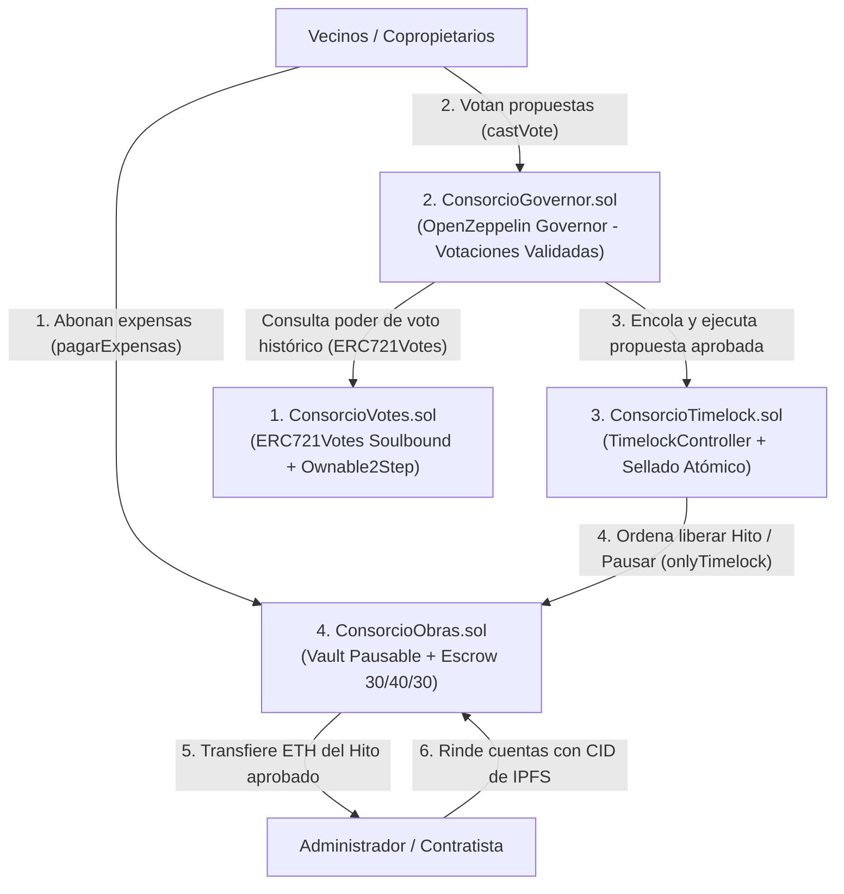
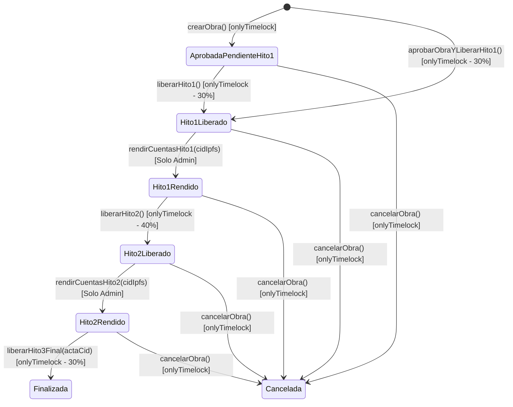

# ADM-Consorcios (ConsorcioDAO) — Gobernanza On-Chain con NFTs Soulbound (`ERC721Votes`) y Bóveda de Obras por Hitos

**Trabajo Práctico Final Integrador — Ethereum Developer Pack (ETH Kipu · Nivel 2)**

> 📊 **Análisis Interactivo EVM & Sepolia:** Podés abrir el archivo [`analisis-evm.html`](./analisis-evm.html) en cualquier navegador web para interactuar con el análisis detallado paso a paso de opcodes, consumo de gas, estados de memoria/storage y las 9 transacciones reales en Sepolia Testnet.

---

## 1. ¿Qué hace el proyecto y cuál es su propuesta de valor?

**ADM-Consorcios (`ConsorcioDAO`)** es un protocolo descentralizado de gobernanza y tesorería programable (*Milestone Escrow Vault*) diseñado para **consorcios de copropietarios, barrios privados (countries) y comunidades habitacionales**.

El sistema resuelve uno de los problemas financieros y de confianza más frecuentes en la administración de propiedades horizontales y urbanizaciones cerradas: **la opacidad en la recaudación de expensas, el desvío o discrecionalidad en el manejo de la caja común y el pago de obras de infraestructura sin control de avance real**.

### Análisis de la Solución: ¿Por qué tiene sentido usar Blockchain para este problema?

1. **Custodia sin intermediarios de confianza (*Trustless Vault*):** En el modelo tradicional, los fondos de expensas descansan en una cuenta bancaria controlada unilateralmente por el Administrador. En `ConsorcioDAO`, los fondos residen en el contrato inteligente `ConsorcioObras.sol`, donde **ninguna persona física puede retirar dinero por su cuenta**: toda erogación requiere una propuesta aprobada por el voto de los propietarios (`ConsorcioGovernor.sol`) y el cumplimiento de una ventana temporal de seguridad (`ConsorcioTimelock.sol`).
2. **Liberación condicionada por Hitos (30% / 40% / 30%) y Rendición de Cuentas en IPFS:** A diferencia de un pago único tradicional, el contrato inteligente divide cada presupuesto aprobado en **tres etapas estrictas**:
   - **Hito 1 (30% — Anticipo y compra de materiales):** Se libera al aprobarse la obra.
   - **Hito 2 (40% — Avance intermedio):** El contrato **bloquea criptográficamente** este pago hasta que el Administrador registre en la blockchain el hash IPFS (`CID`) con las facturas, remitos y fotografías de avance del Hito 1, y los vecinos aprueben la segunda liberación.
   - **Hito 3 (30% — Entrega final):** Exige la rendición de cuentas previa del Hito 2 en IPFS y la aprobación final de cierre de obra.
3. **Poder de voto ligado al inmueble mediante NFTs Soulbound (`ERC721Votes`):** Cada Unidad Funcional o Lote (ej. Lote `101`, UF `102`) está representado por un **NFT único (`tokenId == unidadId`)** en `ConsorcioVotes.sol` basado en `ERC721Votes` y `Ownable2Step` de OpenZeppelin v5. Es **intransferible entre particulares** (*Soulbound*), eliminando de raíz los ataques de préstamo rápido (*flash-loan governance attacks*), reduciendo ~30% el consumo de gas en adjudicaciones/reasignaciones y reflejando con exactitud jurídica el régimen de Propiedad Horizontal.

---

## 2. Arquitectura General del Sistema

El backend on-chain está compuesto por **4 contratos inteligentes modulares** en Solidity `^0.8.24` construidos sobre las primitivas auditadas de **OpenZeppelin Contracts v5.1.0**:



### Detalle de los 4 Contratos (`/contracts`)

| Contrato | Estándar Base | Responsabilidad Principal |
| :--- | :--- | :--- |
| **[`ConsorcioVotes.sol`](./contracts/ConsorcioVotes.sol)** | `ERC721`, `EIP712`, `ERC721Votes`, `Ownable2Step` | Emite un NFT único por unidad funcional (`tokenId = unidadId` en `adjudicarUnidad`), auto-delega el poder de voto al propietario, bloquea transferencias libres (`_update` Soulbound), exige transferencia de propiedad en 2 pasos (`Ownable2Step`) y permite reasignar atómicamente la titularidad del inmueble en caso de compraventa (`reasignarUnidad`). Usa reloj en modo timestamp (`EIP-6372`). |
| **[`ConsorcioTimelock.sol`](./contracts/ConsorcioTimelock.sol)** | `TimelockController` (`AccessControl`) | Bóveda de retardo temporal desplegada con listas `proposers=[]` y `executors=[]` vacías. Impone una espera obligatoria (`minDelay`) entre la aprobación de una propuesta y la salida efectiva de fondos. Incluye la función de sellado atómico `configurarYSellarGobernanza(address governor)` que asigna los roles al Governor y revoca inmediatamente el `DEFAULT_ADMIN_ROLE` del deployer en una sola transacción. |
| **[`ConsorcioGovernor.sol`](./contracts/ConsorcioGovernor.sol)** | `Governor`, `GovernorSettings`, `GovernorCountingSimple`, `GovernorVotes`, `GovernorVotesQuorumFraction`, `GovernorTimelockControl` | Motor de gobernanza. Valida en su constructor que `_votingPeriod > 0` y que el quórum esté en el rango seguro `[4%, 100%]` (`QuorumInvalido`). Gestiona propuestas (`propose`), votación (`castVote`) y encolado/ejecución en el Timelock (`queue` / `execute`). |
| **[`ConsorcioObras.sol`](./contracts/ConsorcioObras.sol)** | `ReentrancyGuard`, `Pausable` + Máquina de Estados de Hitos | Bóveda (Vault) donde ingresan las expensas y se reservan los presupuestos de obras en curso (`fondosComprometidosEnObras`). Protege todas las salidas de dinero con `onlyTimelock`, incorpora freno de emergencia (`pausarVault` / `reanudarVault`), valida la existencia de obras (`ObraInexistente`), bloquea destinatarios circulares (`address(this)` / `timelock`) y exige rendición de cuentas en IPFS antes de destrabar los Hitos 2 y 3. |

### Máquina de Estados de una Obra en `ConsorcioObras.sol`



---

## 3. Evolución Arquitectónica y Cierre de Hallazgos de Auditoría (`CD-01` a `CD-14`)

Tras dos ciclos de auditoría técnica de seguridad sobre la arquitectura y las fronteras de interacción entre contratos, se implementaron las siguientes mejoras estructurales y mitigaciones:

### 3.1. Migración de `ERC20Votes` a `ERC721Votes` en `ConsorcioVotes.sol`

| Dimensión | Diseño Inicial (`ERC20Votes`) | Diseño Mejorado (`ERC721Votes`) | Impacto Técnico y de Negocio |
| :--- | :--- | :--- | :--- |
| **Semántica Legal** | Token fungible con bloqueo artificial | NFT único por Unidad Funcional (`tokenId == unidadId`) | Alineación 1:1 con el registro de propiedad horizontal |
| **Costo de Gas (Adjudicación)** | ~65k–80k gas (`_mint` + mappings extras) | ~45k–55k gas (`_mint` nativo sin mapping de dueño redundante) | Reducción de ~30% al usar `_ownerOf(unidadId)` nativo |
| **Costo de Gas (Reasignación)** | Alto: ejecutaba `_burn` + `_mint` | Transferencia directa vía `_update` con `_reasignacionAutorizada` | Evita doble actualización de suministro total |
| **Seguridad ante Flash Loans** | Basado en saldo fungible acumulado | Cada voto es un NFT único no fungible | Eliminación total de vectores de préstamos flash |
| **Indexación Off-Chain** | Complejo rastrear qué lote vota quién | Directo: `propietarioDeUnidad(unidadId)` / `ownerOf(tokenId)` | Indexación trivial para frontends y auditorías |

### 3.2. Matriz de Cierre de los Hallazgos de Auditoría (`CD-01` a `CD-14`)

| ID | Severidad | Hallazgo | Resolución Implementada |
| :---: | :---: | :--- | :--- |
| **CD-01** | Media | Posible *deadlock* si se transfiere ownership de `ConsorcioVotes` antes de adjudicar unidades | **Resuelto en [`script/Deploy.s.sol`](./script/Deploy.s.sol):** Se adjudican primero las unidades iniciales (`101`, `102`, `103`) con poder de voto activo y recién luego se inicia `transferOwnership`. |
| **CD-02** | Media | Roles residuales permanentes en constructor de `TimelockController` | **Resuelto en [`script/Deploy.s.sol`](./script/Deploy.s.sol) y tests:** Se despliega `ConsorcioTimelock` con `proposers = []` y `executors = []` vacíos; la única vía de otorgamiento es `configurarYSellarGobernanza`. |
| **CD-03** | Media | Tensión operativa en reasignación de unidades por compraventa | **Resuelto en [`ConsorcioVotes.sol`](./contracts/ConsorcioVotes.sol):** Se migró a `Ownable2Step` permitiendo iniciar `transferOwnership(timelock)` en dos pasos o delegar en multisig del consorcio hasta aceptar. |
| **CD-04** | Baja | `pagarExpensas` con `unidadId` declarativo | **Documentado y testeado (`test_CD04_ExpensasSobreUnidadInexistente`):** Se documentó en NatSpec que `unidadId` es declarativo on-chain y se cruza off-chain con `propietarioDeUnidad(unidadId)`. |
| **CD-05** | Baja | `Ownable` de un solo paso en `ConsorcioVotes` | **Corregido en [`ConsorcioVotes.sol`](./contracts/ConsorcioVotes.sol):** Se reemplazó `Ownable` por `Ownable2Step` (`transferOwnership` + `acceptOwnership`). |
| **CD-06** | Baja | Reversión de liberación si contratista no acepta ETH | **Documentado y testeado (`ContratistaSinReceive`):** Se documentó en NatSpec el requisito de que `administradorOContratista` acepte ETH nativo. |
| **CD-07** | Baja | Verificación de identidad del Governor previo al sellado | **Resuelto en [`script/Deploy.s.sol`](./script/Deploy.s.sol):** El script verifica mediante `assert`/`if` on-chain que `governor.token() == votes`, `governor.timelock() == timelock` y que tras el sellado `hasRole(DEFAULT_ADMIN_ROLE, deployer) == false`. |
| **CD-08 a CD-14** | Informativa | Decisiones de diseño (`cancelarObra` sin `whenNotPaused`, semántica de `receive()`, valores de gobernanza) | **Documentados explícitamente en NatSpec y en este README.** |

---

## 4. Estándares de Seguridad y Optimización de Gas Implementados

- **Patrón *Checks-Effects-Interactions* (CEI) + `ReentrancyGuard`:** Todas las funciones que transfieren ETH (`aprobarObraYLiberarHito1`, `liberarHito1`, `liberarHito2`, `liberarHito3Final`) validan precondiciones, actualizan el estado y emiten los eventos **antes** de realizar la llamada externa `.call{value: monto}("")`.
- **Contabilidad de Solvencia (`fondosComprometidosEnObras`):** Al aprobarse una obra, el 100% de su presupuesto queda reservado en `fondosComprometidosEnObras`. La función `saldoLibreDisponible()` impide comprometer fondos en nuevas obras si el efectivo libre del Vault no alcanza para respaldar el 100% de las obras ya aprobadas.
- **Errores Personalizados (`Custom Errors`):** Se reemplazaron todos los strings de `require` por errores personalizados tipados en los 4 contratos, reduciendo el costo de despliegue y de ejecución en caso de revert.
- **Cacheo de Variables de Storage (`SLOAD` Optimization):** Los campos de `obras[obraId]` y `_ownerOf(unidadId)` se cargan en variables locales en pila antes de ser evaluados o emitidos.
- **Bloques `unchecked` Seguros:** Se emplean bloques `unchecked` documentados allí donde las invariantes matemáticas hacen imposible un *overflow* o *underflow* (como el desglose porcentual $30\% + 40\% + 30\% = 100\%$ y el descuento de reservas verificadas).
- **Documentación NatSpec Completa:** Todos los contratos, variables de estado, constantes, eventos, errores personalizados, modificadores y funciones cuentan con etiquetas NatSpec (`@title`, `@author`, `@notice`, `@dev`, `@param`, `@return`).

---

## 5. Cómo Instalarlo y Compilarlo

### Requisitos Previos
- [Foundry (`forge`, `cast`, `anvil`)](https://book.getfoundry.sh/getting-started/installation)
- Git

### Instalación y Compilación Paso a Paso

```bash
# 1. Posicionarse en la carpeta del proyecto
cd /workspace/ADM-Consorcios

# 2. Instalar dependencias (si se clona desde cero)
forge install

# 3. Compilar todos los contratos inteligentes
forge build
```

---

## 6. Cómo Ejecutar los Tests, Invariantes y el Reporte de Coverage

El proyecto cuenta con **2 suites de pruebas automatizadas (`18 tests` en total, 100% aprobados)**:
1. **[`test/ConsorcioDAO.t.sol`](./test/ConsorcioDAO.t.sol):** Pruebas unitarias, flujo principal completo de los 3 hitos (`30% -> 40% -> 30%`), creación en 2 pasos, cancelación en pausa, transferencia en 2 pasos (`Ownable2Step`), fuzzing de reasignación de unidades y todos los casos de `revert`.
2. **[`test/ConsorcioDAOInvariants.t.sol`](./test/ConsorcioDAOInvariants.t.sol):** Harness de *Stateful Fuzzing* (5 invariantes ejecutadas durante 256 corridas y 16,384 llamadas aleatorias con *ghost variables*) que verifica solvencia del Vault (`balance >= fondosComprometidosEnObras`), contabilidad espejo, techo del 100% por obra, inmutabilidad Soulbound y control de acceso `onlyTimelock`.

```bash
# Ejecutar toda la suite de tests e invariantes con reporte de gas
forge test -vv --gas-report

# Ejecutar el reporte de cobertura de código sobre los contratos propios
forge coverage --no-match-coverage "(script|lib|test)"
```

### Resultado Real de Cobertura (`forge coverage`)

| Archivo | % Lines | % Statements | % Branches | % Funcs |
| :--- | :---: | :---: | :---: | :---: |
| `contracts/ConsorcioGovernor.sol` | **66.67%** (16/24) | **80.00%** (20/25) | **50.00%** (1/2) | **45.45%** (5/11) |
| `contracts/ConsorcioObras.sol` | **94.41%** (135/143) | **94.33%** (133/141) | **60.00%** (12/20) | **100.00%** (20/20) |
| `contracts/ConsorcioTimelock.sol` | **90.00%** (9/10) | **90.00%** (9/10) | **50.00%** (1/2) | **100.00%** (1/1) |
| `contracts/ConsorcioVotes.sol` | **95.00%** (38/40) | **97.87%** (46/47) | **100.00%** (7/7) | **88.89%** (8/9) |
| **Total Proyecto** | **91.24% (198/217)** | **93.27% (208/223)** | **67.74% (21/31)** | **82.93% (34/41)** |

---

## 7. Cómo Ejecutar Slither (Análisis Estático de Seguridad Real)

Para correr el analizador estático **Slither (`v0.11.6`)** sobre los contratos propios del proyecto (filtrando librerías externas, scripts y tests):

```bash
slither . --filter-paths "lib/|test/|script/"
```

### Resultado Real de Slither (`56 contracts analyzed with 102 detectors, 3 informational results found`)
No se detectó **ninguna vulnerabilidad Crítica, Alta, Media ni Baja**. Los únicos 3 avisos informativos reportados por Slither están técnicamente justificados:
1. **`low-level-calls` en `ConsorcioObras._transferirETH`:** El uso de `destinatario.call{value: monto}("")` en lugar de `.transfer()` o `.send()` es la práctica recomendada actualmente en Solidity para no romper pagos hacia billeteras multisig (*Smart Accounts*) por el estipendio fijo de 2300 gas. Está blindado con `nonReentrant`, modificador `onlyTimelock`, patrón CEI estricto y verificación del booleano `exito` (`FalloTransferenciaETH`).
2. **`naming-convention` en `ConsorcioVotes.CLOCK_MODE()`:** El nombre en mayúsculas `CLOCK_MODE()` es un requisito obligatorio del estándar **EIP-6372** (`IERC6372`) de OpenZeppelin v5 para declarar el modo de reloj de gobernanza.
3. **`dead-code` en `ConsorcioVotes._increaseBalance(address,uint128)`:** Es un *override* obligatorio exigido por el compilador `solc 0.8.24` al heredar simultáneamente de `ERC721` y `ERC721Votes` en OpenZeppelin v5.

---

## 8. Cómo Ejecutar o Utilizar el Proyecto (Flujo Principal)

El flujo principal del sistema consta de las siguientes etapas:

1. **Adjudicación de Unidades Funcionales (`ConsorcioVotes.adjudicarUnidad`):**
   Se registran las unidades funcionales/lotes emitiendo un NFT (`tokenId = unidadId`) para cada propietario con poder de voto auto-delegado.
2. **Sellado Atómico del Timelock (`ConsorcioTimelock.configurarYSellarGobernanza`):**
   Se vincula el `ConsorcioGovernor` al `ConsorcioTimelock` y el deployer renuncia atómicamente a `DEFAULT_ADMIN_ROLE`.
3. **Pago de Expensas al Vault (`ConsorcioObras.pagarExpensas`):**
   Los vecinos depositan sus expensas en ETH indicando su `unidadId` y concepto (ej. `"Expensas Ordinarias Octubre 2026 - Lote 101"`).
4. **Propuesta de Obra (`ConsorcioGovernor.propose`):**
   Se presenta una propuesta on-chain codificando la llamada a `aprobarObraYLiberarHito1("Reparacion de Luminarias y Acceso Principal", ..., direccionContratista, presupuestoWei)`.
5. **Votación de los Vecinos (`ConsorcioGovernor.castVote`):**
   Los propietarios titulares de NFTs de unidad votan a favor (`1`), en contra (`0`) o abstención (`2`).
6. **Encolado en Timelock y Ejecución (`ConsorcioGovernor.queue` $\rightarrow$ `execute`):**
   Superado el quórum y el período de votación, la propuesta se encola en `ConsorcioTimelock`. Transcurrido el `minDelay`, se ejecuta liberando automáticamente el **Hito 1 (30%)** al contratista.
7. **Rendición de Cuentas en IPFS (`ConsorcioObras.rendirCuentasHito1`):**
   El administrador/contratista sube los comprobantes a IPFS y registra el CID en el contrato, cambiando el estado a `Hito1Rendido` y habilitando la votación del **Hito 2 (40%)** y posteriormente del **Hito 3 Final (30%)**.

---

## 9. Despliegue en Testnet (Sepolia), Contratos Verificados y Transacciones Reales

- **Red Utilizada:** Ethereum Sepolia Testnet (`Chain ID: 11155111`)
- **Billetera Deployer / Vecino Lote 101 / Contratista Demo:** [`0x3b9DE69C652f54582155372d45bB176e810eEEA1`](https://sepolia.etherscan.io/address/0x3b9DE69C652f54582155372d45bB176e810eEEA1)

### Tabla de Contratos Desplegados y Verificados en Etherscan (`Pass - Verified`)

| Contrato | Dirección en Sepolia | URL Directa al Código Verificado en Etherscan |
| :--- | :--- | :--- |
| **`ConsorcioVotes`** | `0x2D3aee1d7090d1129C20815d202a2aC5a54fC9f3` | [https://sepolia.etherscan.io/address/0x2D3aee1d7090d1129C20815d202a2aC5a54fC9f3#code](https://sepolia.etherscan.io/address/0x2D3aee1d7090d1129C20815d202a2aC5a54fC9f3#code) |
| **`ConsorcioTimelock`** | `0x092A28C11A485bBC5A9c5889cED85c3A18b4EC77` | [https://sepolia.etherscan.io/address/0x092A28C11A485bBC5A9c5889cED85c3A18b4EC77#code](https://sepolia.etherscan.io/address/0x092A28C11A485bBC5A9c5889cED85c3A18b4EC77#code) |
| **`ConsorcioGovernor`** | `0x1C910564FA8e017DF66115425F2884233E6509a8` | [https://sepolia.etherscan.io/address/0x1C910564FA8e017DF66115425F2884233E6509a8#code](https://sepolia.etherscan.io/address/0x1C910564FA8e017DF66115425F2884233E6509a8#code) |
| **`ConsorcioObras`** | `0x479f129bD7B42689C65E8e89d11431aBf5Cfe7a6` | [https://sepolia.etherscan.io/address/0x479f129bD7B42689C65E8e89d11431aBf5Cfe7a6#code](https://sepolia.etherscan.io/address/0x479f129bD7B42689C65E8e89d11431aBf5Cfe7a6#code) |

### Evidencia de Transacciones Reales del Flujo Principal en Sepolia

| # | Operación del Flujo Principal | Función Ejecutada | Hash de Transacción / Link en Sepolia Etherscan |
| :-: | :--- | :--- | :--- |
| 1 | Adjudicación de Unidad Funcional 101 (NFT) | `adjudicarUnidad(101, vecino, 100)` | [`0x6d7493c98cd33ff5777f3a7822a314b14a471af8fa22143660c35b4d9024682b`](https://sepolia.etherscan.io/tx/0x6d7493c98cd33ff5777f3a7822a314b14a471af8fa22143660c35b4d9024682b) |
| 2 | Sellado Atómico de Roles en Timelock | `configurarYSellarGobernanza(governor)` | [`0xbbc25a5014bc46fa80fcc819bff18a8946f567620bf5926515a66702773ecd78`](https://sepolia.etherscan.io/tx/0xbbc25a5014bc46fa80fcc819bff18a8946f567620bf5926515a66702773ecd78) |
| 3 | Inicio Transferencia `Ownable2Step` | `transferOwnership(timelock)` | [`0x0d2608dcb7c41586b88ae332c9be15189e60d5962570a9fa915c1b7e71c1504f`](https://sepolia.etherscan.io/tx/0x0d2608dcb7c41586b88ae332c9be15189e60d5962570a9fa915c1b7e71c1504f) |
| 4 | Depósito de Expensas en el Vault | `pagarExpensas(101, "Expensas Ordinarias...")` | [`0xad728ae361d347a1fb51db5d13d3a0bd2d6f1a7bc354c44dfb4f0c1a97958305`](https://sepolia.etherscan.io/tx/0xad728ae361d347a1fb51db5d13d3a0bd2d6f1a7bc354c44dfb4f0c1a97958305) |
| 5 | Creación de Propuesta de Obra #1 | `propose(targets, values, calldatas, desc)` | [`0xc4196f0db3bd1e03efadacfc0240f7732ca1d3cf720a900aa5735493de44a0f4`](https://sepolia.etherscan.io/tx/0xc4196f0db3bd1e03efadacfc0240f7732ca1d3cf720a900aa5735493de44a0f4) |
| 6 | Voto A Favor de la Obra (`support = 1`) | `castVote(proposalId, 1)` | [`0xf4da603947ef364fa5902ab57c61909b69d63ee29f54d9b3fb27794a66f9d20f`](https://sepolia.etherscan.io/tx/0xf4da603947ef364fa5902ab57c61909b69d63ee29f54d9b3fb27794a66f9d20f) |
| 7 | Encolado en Timelock (`queue`) | `queue(targets, values, calldatas, hash)` | [`0xefd369017c99b8c8e7bcafc239f6faa3711d47b857c624700ae4288b3f135829`](https://sepolia.etherscan.io/tx/0xefd369017c99b8c8e7bcafc239f6faa3711d47b857c624700ae4288b3f135829) |
| 8 | Ejecución y Liberación Hito 1 (30%) | `execute(targets, values, calldatas, hash)` | [`0x01bee3a4503f34878ec98ced53758b80c6b44184169ad8a76f2c77491f58b0cf`](https://sepolia.etherscan.io/tx/0x01bee3a4503f34878ec98ced53758b80c6b44184169ad8a76f2c77491f58b0cf) |
| 9 | Rendición de Cuentas Hito 1 (IPFS) | `rendirCuentasHito1(1, "ipfs://QmYwAP...")` | [`0x811aad429cb1d6c9d5e9001eec91a1bdb35d64add513e8cf54745f47a9e325a9`](https://sepolia.etherscan.io/tx/0x811aad429cb1d6c9d5e9001eec91a1bdb35d64add513e8cf54745f47a9e325a9) |

---

## 10. Limitaciones Conocidas del MVP

1. **Denominación en moneda nativa (ETH):** En este MVP los pagos de expensas y presupuestos de obras están denominados en ETH nativo, lo cual expone la tesorería del consorcio a la volatilidad cambiaria frente al dólar o moneda local durante el transcurso de una obra.
2. **Esquema fijo de 3 hitos (30% / 40% / 30%):** La proporción porcentual de los tres tramos está definida mediante constantes (`PORCENTAJE_HITO_1 = 30`, `PORCENTAJE_HITO_2 = 40`, `PORCENTAJE_HITO_3 = 30`). Obras muy pequeñas o de más de 3 etapas requieren adaptarse a este esquema.
3. **Verificación de comprobantes IPFS por consenso social:** El contrato valida que el administrador cargue un CID de IPFS no vacío antes de habilitar el siguiente hito, pero la validación de que las facturas subidas a IPFS sean auténticas depende de la revisión visual de los vecinos antes de emitir su voto para el siguiente tramo.
4. **Poder de voto simétrico por Unidad Funcional (`1 NFT = 1 Voto`):** Con `ERC721Votes` cada unidad funcional representa 1 voto atómico en el Governor (mientras que su alícuota porcentual queda registrada en `cuotaParteDeUnidad[unidadId]`). Para consorcios que requieran voto ponderado por metros cuadrados exactos además del NFT por unidad, se contempla un módulo híbrido en el Roadmap.

---

## 11. Roadmap de Desarrollo (Próximos Pasos Técnicos)

### Fase 2: Estabilidad Financiera y Oráculos
1. **Pagos de Expensas y Presupuestos en Stablecoins (`ERC-20` + `SafeERC20`):**
   Integrar soporte para **USDC / USDT / DAI** utilizando la librería `SafeERC20` de OpenZeppelin, eliminando el riesgo de volatilidad de ETH en la caja del consorcio.
2. **Integración con Chainlink Data Feeds (`AggregatorV3Interface`):**
   Permitir que los presupuestos se fijen en USD y que `ConsorcioObras` consulte en tiempo real el oráculo `ETH / USD` de Chainlink para calcular el equivalente exacto al momento de liberar cada hito.
3. **Automatización de Vencimientos con Chainlink Automation (*Keepers*):**
   Implementar `AutomationCompatibleInterface` para ejecutar automáticamente el encolado (`queue`) y la ejecución (`execute`) de propuestas aprobadas apenas vence el `minDelay`, y para aplicar recargos automáticos por mora en expensas vencidas.

### Fase 3: Escalabilidad, UX y Resolución de Disputas
4. **Arbitraje Descentralizado en Obras Canceladas (Estándar `ERC-792` / Kleros):**
   Integrar un módulo de arbitraje externo para casos de disputa entre el consorcio y el contratista sobre la calidad de entrega de un hito.
5. **Abstracción de Cuentas (`ERC-4337` Account Abstraction + Paymaster):**
   Implementar billeteras inteligentes con inicio de sesión social (email/passkeys) y patrocinio de gas (*Gasless Voting*) para que vecinos sin conocimientos técnicos de criptomonedas puedan votar y pagar expensas sin necesitar comprar ETH para gas.
6. **Despliegue Multichain en Redes Layer 2 (Arbitrum / Optimism / Base):**
   Migrar la operación diaria a una red L2 para reducir el costo de cada voto de los vecinos a menos de \$0.01 USD.
